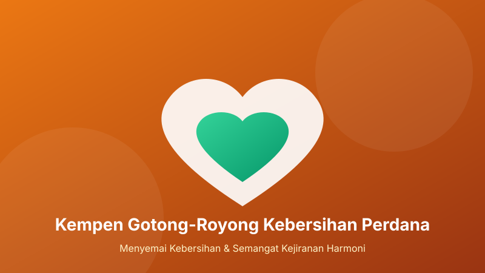

# Laporan Kempen Gotong-Royong Kebersihan Perdana

Alhamdulillah, pada hujung minggu yang lalu telah berlangsung Kempen Gotong-Royong Kebersihan Perdana bertempat di kawasan musolla dan fasiliti sekitar.

Program ini telah berjaya mengumpulkan lebih 60 orang sukarelawan yang terdiri daripada golongan belia, ibu bapa dan kanak-kanak.

## Skop Kerja yang Dilaksanakan

Aktiviti dibahagikan kepada 4 zon utama bagi memastikan kelancaran:

- **Zon A (Ruang Solat Utama)**: Pemvakuman mendalam (*deep vacuuming*) karpet solat, pengelapan cermin tingkap dan penyusunan semula mashaf Al-Quran.
- **Zon B (Kawasan Wuduk & Tandas)**: Pembersihan jubin lantai dengan pencuci antikulat, penggantian kepala paip yang bocor dan semburan pewangi berkala.
- **Zon C (Kaki Lima & Laluan Masuk)**: Penyusunan rak kasut jemaah, penyapuan daun kering dan pembersihan sawang.
- **Zon D (Bilik Jamuan & Dapur)**: Penyusunan cawan, penyediaan bekalan air minuman dan pelupusan barang lama.

## Penghargaan & Jamuan Ringkas

Pihak jawatankuasa merakamkan setinggi-tinggi penghargaan dan ucapan jazakumullahu khairan kathira kepada:
1. Para penaja yang menyumbangkan makanan sarapan pagi, kuih-muih dan air mineral.
2. Seluruh penduduk blok atas komitmen masa dan tenaga yang dicurahkan.

Semoga usaha ini memupuk ukhuwah yang kukuh sesama jiran tetangga di samping merealisasikan moto: *"Kebersihan Sebahagian Daripada Iman"*.
