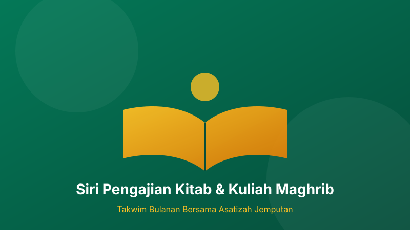

# Takwim Pengajian Kitab & Kuliah Maghrib

Menuntut ilmu adalah kewajipan bagi setiap Muslim. Bagi mengimarahkan rumah Allah dengan majlis ilmu dan zikir, Biro Dakwah menyusun siri kuliah berkala sepanjang bulan ini.

## Jadual Mingguan Pengajian

| Hari | Bidang Pengajian | Kitab Rujukan | Penceramah |
| :--- | :--- | :--- | :--- |
| **Isnin** | Fiqh Ibadah | *Matan Safinah an-Naja* | Ustaz Ahmad Fauzi |
| **Rabu** | Hadis & Sunnah | *Riyadhus Solihin* | Ustaz Mohamad Hafiz |
| **Jumaat** | Tazkirah Jumaat | *Pembersihan Jiwa (Tazkiyatun Nafs)* | Penceramah Jemputan |
| **Sabtu (Subuh)** | Tadabbur Al-Quran | *Tafsir Ayat Pilihan* | Ustaz Khairul Anuar |

## Adab-adab Menghadiri Majlis Ilmu

1. Berwuduk dan berniat ikhlas kerana Allah Taala.
2. Membawa buku catatan atau kitab rujukan berkaitan.
3. Menjaga ketenangan dan kebersihan ruang solat.
4. Memarkir kenderaan di petak yang ditetapkan tanpa menghalang laluan penduduk.

> Rasulullah SAW bersabda: *"Barangsiapa menempuh suatu jalan untuk mencari ilmu, maka Allah akan memudahkan baginya jalan menuju syurga."* (HR. Muslim)

Dijemput seluruh muslimin dan muslimat bersama ahli keluarga hadir mengimarahkan majlis yang diberkati ini.
