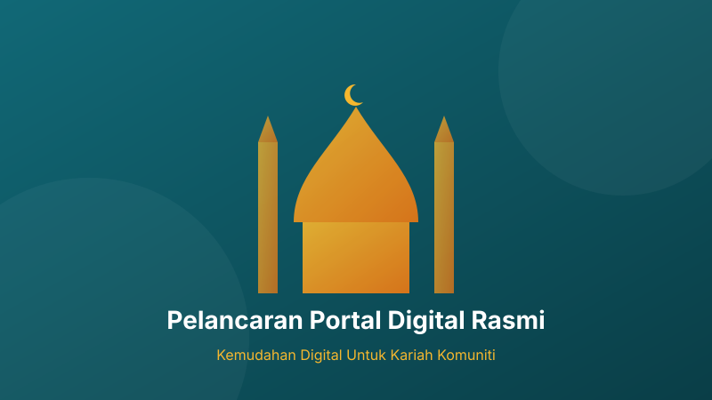

# Pelancaran Portal Digital Rasmi

Segala puji bagi Allah SWT, Tuhan sekalian alam. Selawat dan salam ke atas junjungan besar Nabi Muhammad SAW, ahli keluarga dan para sahabat baginda.

Pihak pentadbiran dengan rasa penuh kesyukuran mengumumkan pelancaran portal rasmi ini. Laman web ini dibangunkan berasaskan konsep ketelusan, keterbukaan maklumat serta ukhuwah komuniti setempat.

## Objektif Utama Portal

Portal ini direka khas untuk memenuhi keperluan seluruh jemaah kariah melalui beberapa ciri utama:

1. **Penyata Kewangan Berkala**: Jemaah boleh menyemak laporan kewangan bulanan dan tahunan secara terus dalam format PDF yang diaudit.
2. **Pendaftaran Khairat Kematian**: Pautan terus ke sistem e-Khairat bersama Masjid Al-Ilmi Dengkil.
3. **Takwim Pengajian & Aktiviti**: Jadual kuliah Maghrib, tazkirah Subuh dan gotong-royong sentiasa dikemaskini.
4. **Saluran Infaq Digital**: Kemudahan salin nombor akaun Bank Islam dan imbasan kod QR DuitNow tanpa sebarang caj tersembunyi.

> "Perumpamaan orang yang menginfakkan hartanya di jalan Allah seperti sebutir benih yang menumbuhkan tujuh tangkai, pada setiap tangkai ada seratus biji. Allah melipatgandakan bagi sesiapa yang Dia kehendaki." (Surah Al-Baqarah: 261)

## Struktur Pengurusan Kandungan

Portal ini menggunakan arkib berasaskan fail statik berprestasi tinggi. Hebahan artikel blog disusun mengikut tarikh standard:
- Struktur direktori: `/blog/<year>/<month>/<day>/<post_folder>/`
- Format paparan tarikh pada laman web: **26/10/2026** `<DD>/<MM>/<YYYY>`

Semoga usaha kecil ini menjadi asbab penyatuan hati dan kemakmuran rumah Allah. Sebarang cadangan penambahbaikan boleh disalurkan melalui borang maklum balas rasmi kami.
